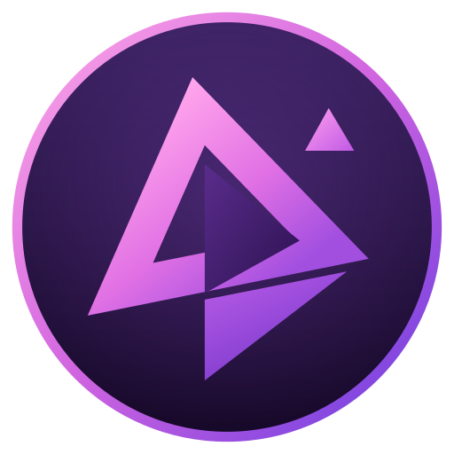
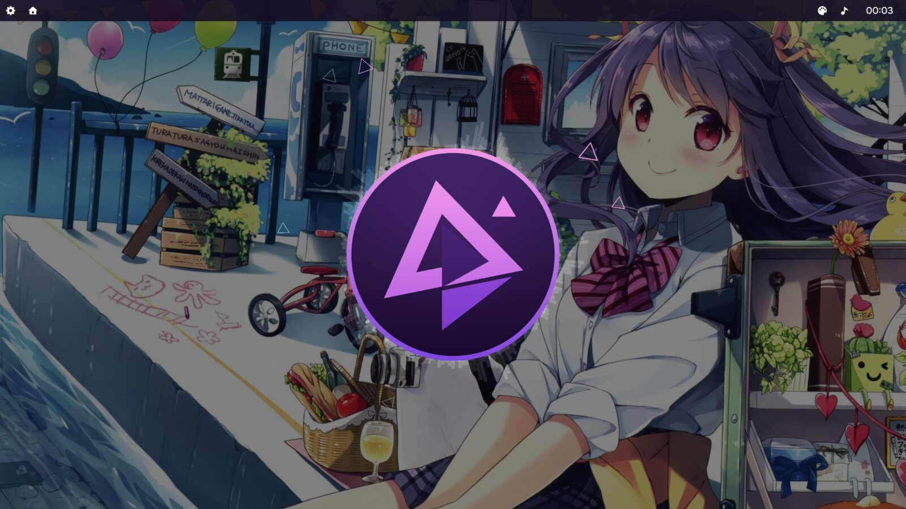
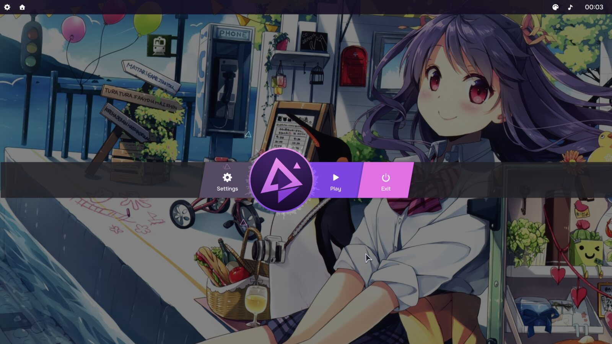
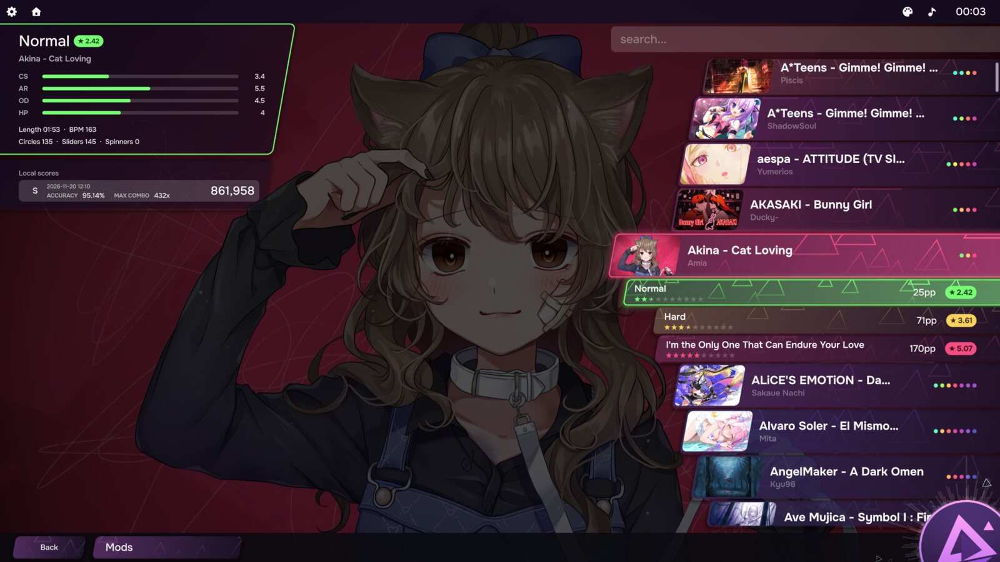
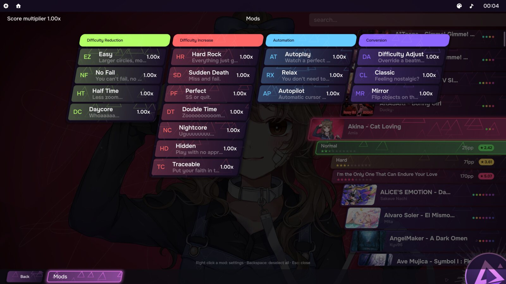
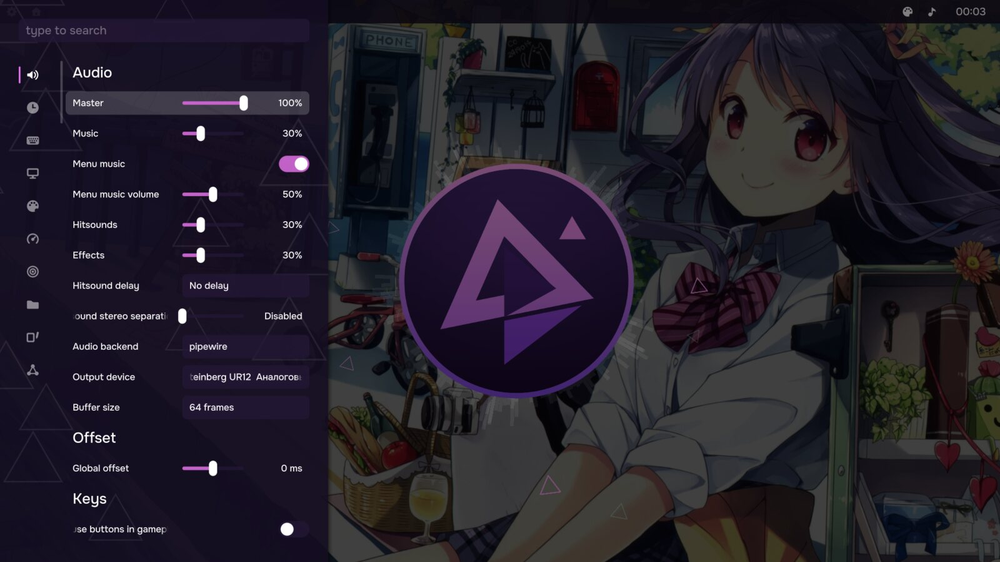
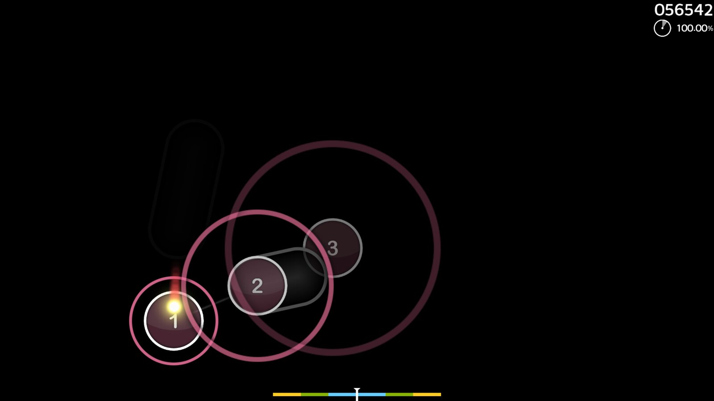

  

<h1 align="center">SLAM</h1>

<b>Stable Lazer Always Mythical</b>

A standalone open-source osu!standard client — low latency, stable and lazer beatmaps, skins and replays, Luau plugins.

  
  
  

<b>English</b> · <a href="README.ru.md">Русский</a> · <a href="https://github.com/sheynor43/SLAM/releases">Download</a>

## Screenshots

<table>
<tr>
<td> Main menu: the logo beats to the music</td>
<td> Lazer-style buttons out of the logo</td>
</tr>
<tr>
<td> Song select</td>
<td> Mod select</td>
</tr>
<tr>
<td> Settings</td>
<td> Gameplay with the default skin</td>
</tr>
</table>

## Features

- **Low latency**: separate input, update, draw and audio threads; frame limiter and 1000 Hz+ updates.
- **Two rule profiles**: lazer judgement now, stable rules in progress.
- **Your stuff as is**: stable `Songs`, `.osz`/`.olz`, stable and lazer skins, `.osr` replays.
- **Interface after lazer and stable**: beating logo menu in either style, curved song list, mod select with presets, colour schemes incl. SLAM.
- **OpenTabletDriver settings** right in the game; Linux and Windows.

> SLAM is an independent project and is not affiliated with ppy Pty Ltd. "osu!" is a trademark of ppy.

## Alpha for testers

Builds are published under [Releases](https://github.com/sheynor43/SLAM/releases) as pre-releases. This is an early alpha: a lot is missing and crashes are possible. Fixes for common problems are in the release notes.

**System requirements**
- Windows 10+ x64 or Linux x64 (X11 or Wayland, glibc as new as Ubuntu 24.04 or newer).
- A graphics card with OpenGL 3.3. On Windows, Direct3D 11 can be chosen in the settings instead; SLAM also switches to it when OpenGL fails to start.
- Linux: PipeWire for sound; xdg-desktop-portal or zenity for the folder picker.

**Running**
- Windows: extract `SLAM-…-windows-x64.zip` anywhere and run `slam.exe`.
- Linux: `chmod +x SLAM-…-x86_64.AppImage`, then run the file.
- If your beatmap folder was not found automatically, choose it in the settings: osu!stable's `Songs` or any folder with extracted `.osz` files.

**Where the settings live**
- Windows: `%APPDATA%\SLAM`; Linux: `~/.config/slam` (settings) and `~/.local/share/slam` (replays, cache).
- Portable mode: put an empty file named `portable` next to `slam.exe`, and settings and data are kept next to it.

**Reporting a bug**
The quickest way is Settings → Feedback → Report a bug in the game: it opens a pre-filled issue form with your version, OS and GPU.

Or open an [issue](https://github.com/sheynor43/SLAM/issues/new) with:
- the SLAM version and your OS;
- what you did, what you expected and what happened;
- the beatmap, if the bug is related to one (an osu.ppy.sh link or the file);
- the log `slam.log` (the previous runs are `slam.1.log`…`slam.4.log`) from the `logs` folder: Windows — `%APPDATA%\SLAM\logs`, Linux — `~/.local/share/slam/logs`, portable mode — `logs` next to `slam.exe`. If SLAM stops with an error, the error window shows where the log is.

Issues are welcome in English or Russian.

## Documentation
The design documents are written in Russian.
- [Architecture](docs/ARCHITECTURE.md)
- [Roadmap](docs/ROADMAP.md)
- [Architecture decision records (ADR)](docs/adr/README.md)
- [Reference osu!lazer version](docs/LAZER_REFERENCE.md)
- [Current work](https://github.com/sheynor43/SLAM/milestones)

## License
SLAM is free software, licensed under the GNU General Public License v3.0 or later (`GPL-3.0-or-later`), see [`LICENSE`](LICENSE). Releases up to and including `v0.1.0-alpha` were published under MIT or Apache-2.0.

The default skin in `assets/default-skin/` comes from [osu-resources](https://github.com/ppy/osu-resources) and is licensed under CC-BY-NC 4.0, not the GPL, so it may not be used commercially. Commercial forks need to replace it. Attribution is in [`assets/default-skin/README.md`](assets/default-skin/README.md).

Parts of the gameplay logic are ported from [osu!lazer](https://github.com/ppy/osu) (MIT), see `THIRD_PARTY_NOTICES`. Behaviour of osu!stable that lazer does not reproduce is taken from [McOsu](https://github.com/McKay42/McOsu) (GPL-3.0).
