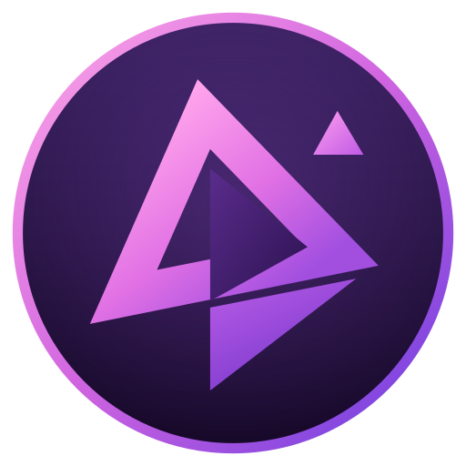
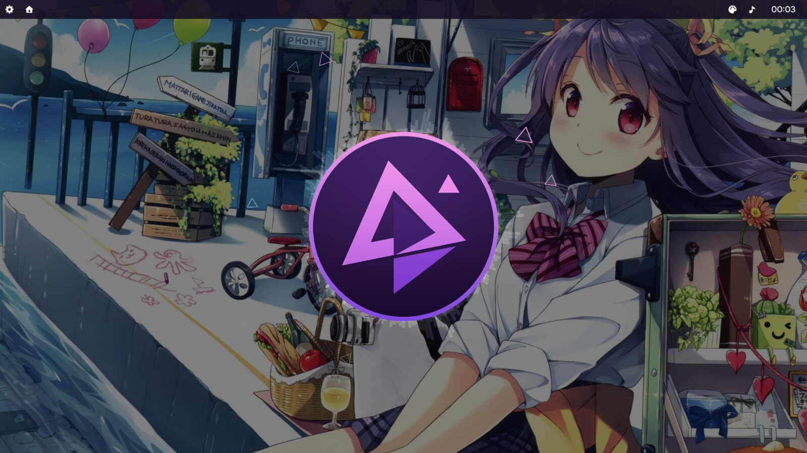
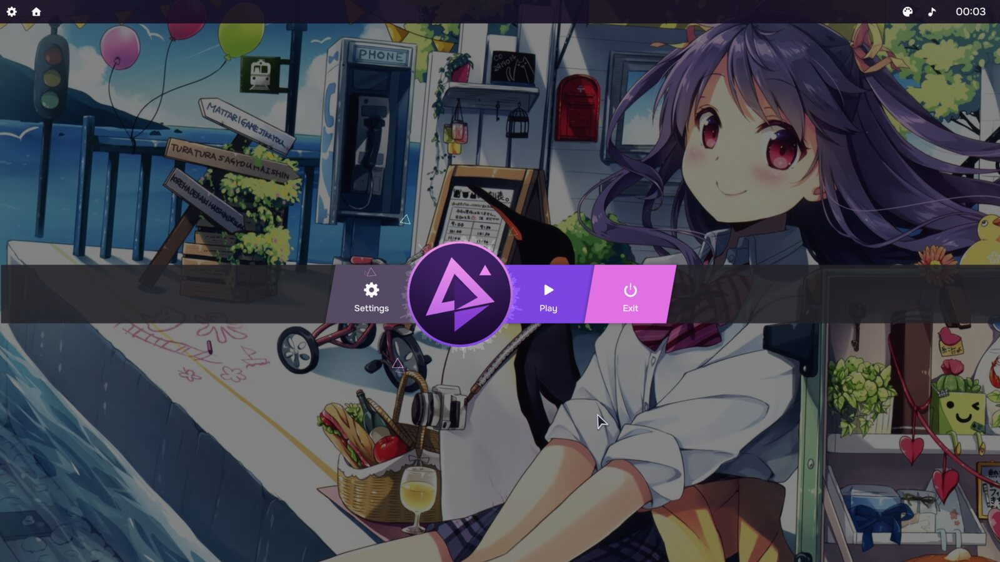
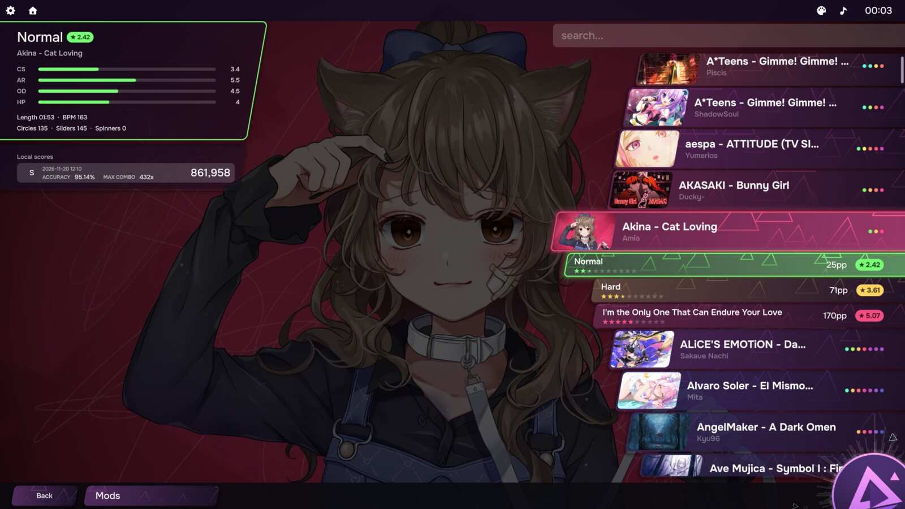
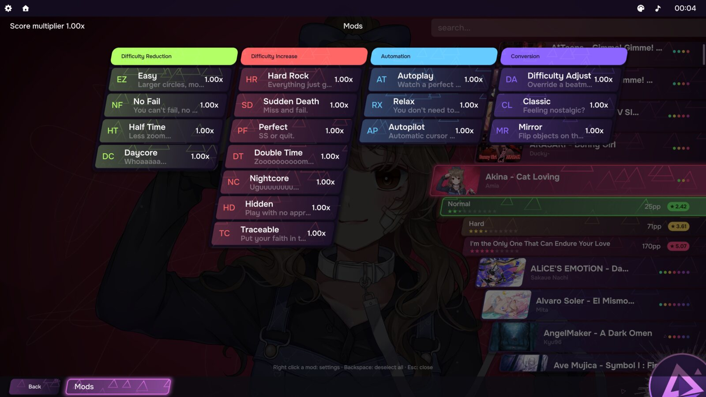
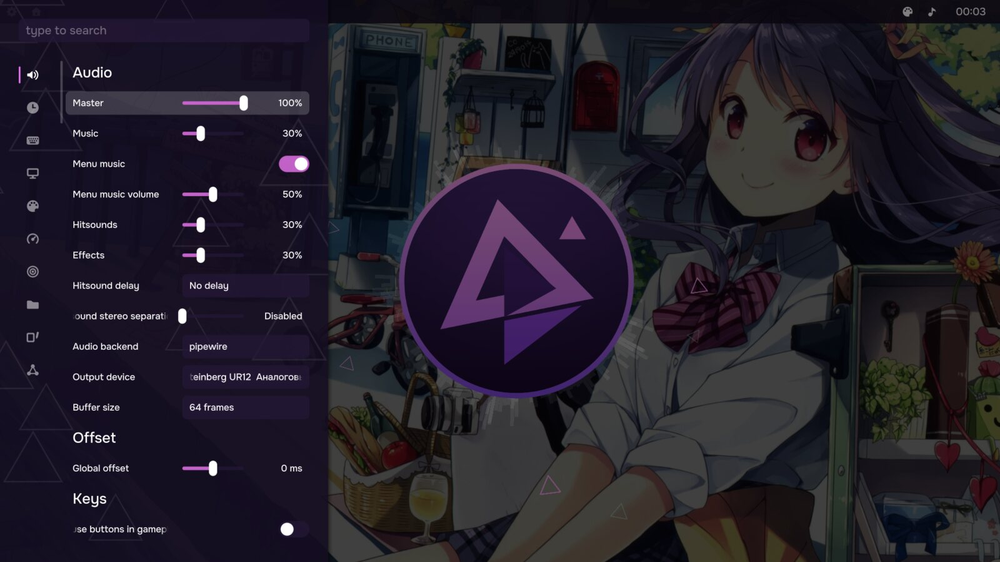
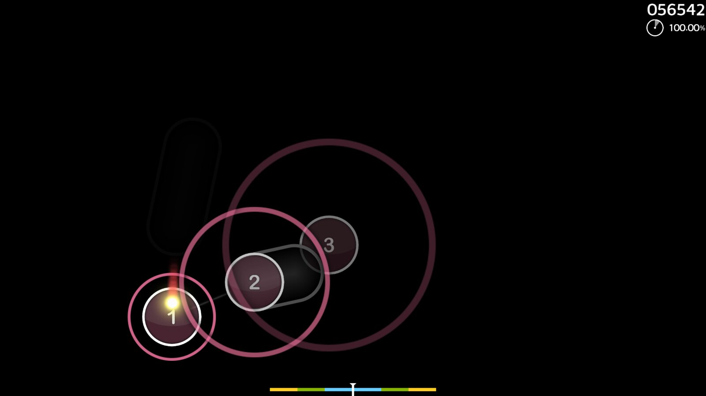

  

<h1 align="center">SLAM</h1>

<b>Stable Lazer Always Mythical</b>

Самостоятельный клиент osu!standard с открытым кодом — низкая задержка, карты, скины и реплеи stable и lazer, плагины на Luau.

  
  
  

<a href="README.md">English</a> · <b>Русский</b> · <a href="https://github.com/sheynor43/SLAM/releases">Скачать</a>

## Скриншоты

<table>
<tr>
<td> Главное меню: логотип стучит в такт музыке</td>
<td> Кнопки в стиле лазера</td>
</tr>
<tr>
<td> Выбор песни</td>
<td> Выбор модов</td>
</tr>
<tr>
<td> Настройки</td>
<td> Игра с встроенным скином</td>
</tr>
</table>

## Возможности

- **Низкая задержка**: отдельные потоки ввода, обновления, отрисовки и звука; ограничитель кадров и обновление от 1000 Гц.
- **Два профиля правил**: судейство лазера уже есть, правила stable в работе.
- **Всё ваше как есть**: `Songs` из stable, `.osz`/`.olz`, скины stable и lazer, реплеи `.osr`.
- **Интерфейс по лазеру и stable**: меню с логотипом в такт в любом из двух видов, изогнутый список песен, моды с пресетами, цветовые темы, в том числе SLAM.
- **Настройка OpenTabletDriver** прямо в игре; Linux и Windows.

> SLAM — независимый проект и не связан с ppy Pty Ltd. «osu!» — товарный знак ppy.

## Альфа-версия для тестеров

Сборки лежат в [Releases](https://github.com/sheynor43/SLAM/releases) с пометкой pre-release. Это ранняя альфа: многого нет, возможны вылеты. Решения типичных проблем — в описании релиза.

**Системные требования**
- Windows 10+ x64 или Linux x64 (X11 или Wayland, glibc не старше Ubuntu 24.04).
- Видеокарта с OpenGL 3.3. На Windows вместо него в настройках можно выбрать Direct3D 11; на него же SLAM переключается, если OpenGL не запустился.
- Linux: PipeWire (звук), для выбора папки — xdg-desktop-portal или zenity.

**Запуск**
- Windows: распакуйте `SLAM-…-windows-x64.zip` в любую папку и запустите `slam.exe`.
- Linux: `chmod +x SLAM-…-x86_64.AppImage` и запустите файл.
- Если папка с картами не нашлась сама, укажите её в настройках: `Songs` из osu!stable или любая папка с распакованными `.osz`.

**Где лежат настройки**
- Windows: `%APPDATA%\SLAM`; Linux: `~/.config/slam` (настройки) и `~/.local/share/slam` (реплеи, кэш).
- Портативный режим: положите пустой файл `portable` рядом с `slam.exe` — настройки и данные будут храниться рядом с ним.

**Как сообщить об ошибке**
Проще всего открыть в игре Настройки → Связь → Сообщить об ошибке: откроется форма issue с уже заполненными версией, ОС и видеокартой.

Или создайте [issue](https://github.com/sheynor43/SLAM/issues/new) и укажите:
- версию SLAM и ОС;
- что делали, что ожидали и что произошло;
- карту, если ошибка связана с ней (ссылку на osu.ppy.sh или файл);
- лог `slam.log` (прошлые запуски — `slam.1.log`…`slam.4.log`) из папки `logs`: Windows — `%APPDATA%\SLAM\logs`, Linux — `~/.local/share/slam/logs`, портативный режим — `logs` рядом с `slam.exe`. Если SLAM остановился с ошибкой, окно ошибки показывает, где лежит лог.

Issue можно писать на русском или английском.

## Документация
- [Архитектура](docs/ARCHITECTURE.md)
- [Дорожная карта](docs/ROADMAP.md)
- [Решения (ADR)](docs/adr/README.md)
- [Эталонная версия osu!lazer](docs/LAZER_REFERENCE.md)
- [Текущие задачи](https://github.com/sheynor43/SLAM/milestones)

## Лицензия
SLAM — свободная программа под лицензией GNU General Public License версии 3 или любой более поздней (`GPL-3.0-or-later`), см. [`LICENSE`](LICENSE). Выпуски до `v0.1.0-alpha` включительно выходили под MIT или Apache-2.0.

Дефолтный скин в `assets/default-skin/` взят из [osu-resources](https://github.com/ppy/osu-resources) и распространяется по лицензии CC-BY-NC 4.0, а не GPL, — его нельзя использовать в коммерческих целях. Коммерческим форкам нужно заменить скин. Атрибуция — в [`assets/default-skin/README.md`](assets/default-skin/README.md).

Часть логики геймплея портирована из [osu!lazer](https://github.com/ppy/osu) (MIT), см. `THIRD_PARTY_NOTICES`. Поведение osu!stable, которого нет в лазере, берётся из [McOsu](https://github.com/McKay42/McOsu) (GPL-3.0).
